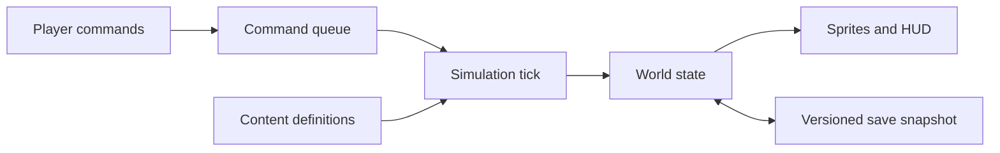

# GOPALA — Dawn of the Valley

## 2D Godot Development Vedas

Prepared 29 September 2026. Status: scope baseline; foundation and landscape implementation have started.

Presentation update: the user authorizes mixing 2D and 3D for quality and development speed. The main landscape now uses native 3D terrain with an orthographic camera and the same style of logical settlement grid. See [Landscape layer](GOPALA-Landscape-Layer.md) for the current implementation and acceptance boundary. The original 2D recommendations below remain reference material; gameplay scope and physical logistics remain the baseline.

**Build a fixed-camera, 2D isometric settlement game in Godot. Start with one playable valley, visible workers, physical construction, and a cattle-based food economy. Expand only after that loop works.**

The player guides a community from a cattle camp to a permanent village. Townsmen 6 supplies the reference for accessible settlement management; GOPALA supplies its own setting, economy, art, and progression.

This document supersedes the shared plan's Unity/URP recommendation for the requested 2D release. It preserves the later, Gopala-specific concept: cattle, households, land transformation, water, practical knowledge, and community leadership. It deliberately reduces the original launch content counts. [Original plan](https://chatgpt.com/share/6a78b134-47a4-83ea-8987-ad5e47177252).

## 1. Decisions to use as the project baseline

| Decision | Recommendation | Reason |
|---|---|---|
| Engine | Godot 4.7.2 Standard, pinned for the first milestones | A verified stable release; avoids building against development snapshots |
| Language | Typed GDScript | Direct fit for the linked lessons and quick Godot iteration |
| Renderer | Compatibility initially | Suitable baseline for a sprite game and broad hardware support |
| Presentation | 2D sprites on a 2:1 isometric ground grid | Townsmen-like spatial readability with a controlled art workload |
| Camera | Pan and zoom; one fixed orientation | One consistent set of building views |
| Controls | Settlement commands and worker allocation | The player manages the community; villagers perform individual actions |
| First validation platform | Desktop, including macOS for development | Easier iteration and inspection of simulation problems |
| Port direction | Landscape Android after the slice; test one touch layout early | Prevents a late UI redesign without requiring two releases immediately |
| World | One handcrafted Kathmandu Valley-inspired map | Reliable food, access, and event balancing |
| Economy | Physical inventories and hauling; barter for the initial setting | Logistics creates meaningful choices; avoids making royal taxation the opening mechanic |
| Release model | Offline single-player, proposed paid game | Complete sessions, local saves, no real-time waiting economy |

Platform and commercial model are planning assumptions because the request does not specify them. Reconfirm before platform-specific production or store work. No purchases or installs are required to use this roadmap.

Godot's [archive](https://godotengine.org/download/archive/) lists 4.7.2 as stable, while 4.8 is a development branch at the research date. Use matching export templates. The [renderer guide](https://docs.godotengine.org/en/stable/tutorials/rendering/renderers.html) supports Compatibility as a starting point for 2D and older hardware. These choices do not establish a measured performance guarantee.

## 2. What to take from Townsmen 6

The exact reference matters: **Townsmen 6 Premium** includes production, citizen needs, task assignment, upgrades, weather, campaign/open-ended play, and a military/political campaign. It is distinct from the later Townsmen and A Kingdom Rebuilt releases. [Official Premium listing](https://play.google.com/store/apps/details?id=com.hg.townsmen6).

| Reference element | GOPALA adaptation | Timing |
|---|---|---|
| Readable settlement planning | Clear footprints, costs, worker counts, and operating status | First playable |
| Resource cycle | Gather → carry → store → build/consume/process | First playable |
| Citizens with needs | Food, water, shelter; later warmth and household satisfaction | First playable onward |
| Productive workforce | Assign workers to buildings and zones; automatically dispatch tasks | First playable |
| Progression | Camp → hamlet → permanent village, with action-earned knowledge | Slice onward |
| Weather affecting decisions | Rain helps pasture but slows transport; dry periods reduce grazing | Slice |
| Campaign plus endless play | Short goal-based introduction, then continue the same settlement | Slice |
| Strategic campaign and conflict | Regional relationships and optional defense after economic validation | Later release/expansion |
| Procedural replayability | Handcrafted first map; tested seed generation later | After alpha |

V1 will capture the settlement experience rather than claim complete Townsmen 6 feature parity. Military systems and a strategic regional map remain explicit deferred work. Create original assets, writing, interface layouts, and scenarios.

## 3. The best ideas for this particular game

### Cattle are an economic decision

The herd consumes pasture or stored fodder and water. Supported cattle provide milk; later manure supports fields and dairy production creates trade surplus. More cattle are valuable only while the community can feed and tend them.

Give the player three legible choices: reserve pasture, move a herd to rested pasture, or spend labor on fodder storage. Show remaining grazing capacity and estimated fodder days. Introduce overgrazing only after basic husbandry is reliable.

### Land allocation creates the main tension

Forest, fields, settlement, and pasture compete for space. Clearing a tile yields timber and building space but removes a gathering or grazing opportunity. Begin with simple tile values for vegetation, moisture, fertility, and walkability. Add ecosystem interactions incrementally.

### Water and rain connect the economy

Build the first map around a river, accessible dry ground, meadow, and woodland. Low ground can be fertile but exposed to a forecast rain event. Water collection needs workers and carrying time. Add irrigation as connected-channel coverage later; a fluid simulation is unnecessary for this design.

### Construction makes growth visible

Use three initial images per building: blueprint, frame, complete. Materials must arrive and builders must work before a structure operates. Later variants can add more construction stages. This preserves the original plan's physical growth without requiring every wall to be a separate simulated object.

### People belong to households

Start with names, home assignment, occupation, current task, and unmet needs. Add household grouping in the slice and immigration in alpha. Marriage, genealogy, aging, and births are valuable later features but should not delay construction or food systems.

### Learning comes from work

Count completed activities toward a few explicit milestones: gather enough fodder to learn protected storage; maintain a food surplus to unlock a granary; process dairy to unlock better trade. Display progress and requirements. Do not hide unlocks behind random discovery rolls.

### The landscape records the settlement

A later trail system can increment a tile's traffic value when an agent crosses it. At a threshold, show dirt and allow an upgrade to a maintained path. Keep navigation and terrain values authoritative; trail art follows them. Begin with player-painted paths so routing is easy to debug.

**Design pillars:** understandable logistics; cattle and land stewardship; visible community growth; Nepali identity through gameplay and art.

## 4. Convert the original 3D plan into 2D

| Original plan | 2D implementation |
|---|---|
| Unity terrain and a large valley | TileMapLayer ground, river edges, meadow, forest, and authored terrace shapes |
| Terrain elevation | Discrete tile metadata and decorative slopes; one navigable surface initially |
| Free-form placement | Hidden grid with varied footprints, visual offsets, and irregular decorations |
| NavMesh agents | AStarGrid2D in logical cell coordinates, with authoritative obstacle data |
| 3D prefabs | PackedScene views: Sprite2D/AnimatedSprite2D, footprint, selection marker, effects |
| ScriptableObjects | Custom Godot Resource definitions saved as .tres |
| C# simulation managers | Central tick scheduler with typed GDScript systems and runtime records |
| LOD models and distant agents | Visible sprite culling and simpler visual animation; economic time remains consistent |
| Dynamic 3D lighting | Authored sprite shading, shared shadows, color modulation, limited 2D effects |
| 3D construction stages | Blueprint/frame/complete sprite states |
| Large ecology simulation | Tile-level grass, tree regrowth, forage stock, and simple seasonal modifiers |
| Full family simulation | Household membership and needs first; life events later |

The grid is a technical simplification. The art can still look organic: vary dwelling silhouettes, rotate decorations where supported, leave uneven clearings, and place props with offsets inside the footprint. Do not begin with arbitrary free placement or camera rotation.

The current game-housing.png and village1.png are useful mood references. They depict elaborate houses and religious landmarks, so they should not determine the early Gopala asset list. Use the shared plan's later direction: timber, thatch, earth, fieldstone, baskets, pottery, and cattle infrastructure. Treat specific architecture and crops as reconstruction candidates pending research.

## 5. Scope by playable result

### P0 — first functioning settlement

- One 48×48 logical-cell test map.
- Start with 8 adult settlers and 2 cattle; these are balance seeds, not historical claims.
- Six placeable structures: dwelling, stockpile, timber camp, gatherer shelter, water point, cattle shelter.
- One pasture zone.
- Seven resource types: timber, stone, thatch, water, wild food, fodder, milk.
- Gather, carry, construct, tend cattle, and satisfy food/water needs.
- Simple grazing consumption and milk output; expanded cattle management comes next.
- Selection, assignment, pause, 1×/2×/4× speed, status indicators, manual save/load.
- A short objective: establish shelter and maintain food and water reserves.

P0 is complete when a new player can construct a dwelling, feed the community, see resources transported, save, reload, and continue for 15 minutes without developer intervention.

### P1 — coherent 30–45 minute vertical slice

- One 96×96 handcrafted valley map; finalize size after traversal testing.
- Target 30–50 residents and 4–8 cattle by the scenario end.
- Twelve placeable structures/spaces, listed below, plus two zone types: pasture and field.
- Eleven resource types: P0's seven plus grain, meals, dairy, and dung.
- One generic cereal and one fodder crop definition initially; final species and names follow research.
- Physical construction and hauling, household grouping, meaningful cattle support.
- Dry → rainy → harvest → cool/dry phases, using tunable temperature/rain/moisture values.
- One forecast rain/flood challenge; simple grass and tree recovery.
- Three settlement stages, six practical-knowledge unlocks, basic barter.
- Tutorial objectives, optional continued sandbox, clear recovery from shortages.
- Versioned saves, audio, cohesive representative art, and a tested desktop export.

| Placeable | Job in the slice |
|---|---|
| Dwelling | Housing and household assignment |
| Stockpile | General materials and water storage |
| Timber camp | Timber collection and controlled clearing |
| Gatherer shelter | Wild food, thatch, and surface stone collection |
| Water point | Water supply from a valid source |
| Cattle shelter | Herd support and milk collection |
| Fodder store | Protection and capacity for harvested fodder |
| Cooking shelter | Grain/wild food + fuel → meals |
| Granary | Better grain capacity and retention |
| Dairy hut | Milk + labor → longer-lasting dairy |
| Barter stall | Periodic exchange of surplus for missing materials |
| Communal space | Household satisfaction and progression requirement |

The communal space is an outdoor buildable arrangement. Pastures and fields are zones, not additional building models. Species, dairy technique, fuel use, storage forms, and construction details remain game abstractions until culturally reviewed.

### P2 — functioning alpha

Expand to roughly 18–20 structures, 15–18 resources, 80–100 villagers, improved irrigation, pottery/tools, more events, immigration, household satisfaction, and a second scenario. Add deliberate balance variation before procedural worlds.

### V1 — small complete game

Aim for 20–25 structures, 3–5 authored scenarios sharing reusable map systems, a researched Chronicle, sandbox continuation, and stable desktop release. A campaign length is a playtest result, not a content promise. Add Android release only after device performance, touch interaction, saves, and lifecycle behavior are validated.

Defer full genealogy, combat armies, diplomacy simulation, multi-era history, complex hydrology, terrain sculpting, multiplayer, and thousands of agents. The original ambition remains a future direction, with each expansion judged against a working game.

## 6. Production chains and balance

| Chain | Important player decision |
|---|---|
| Vegetation → timber/thatch → construction | How much land to clear and how far builders carry materials |
| Source → collected water → households/cattle | Labor and carrying distance versus settlement location |
| Forage → food → household consumption | Immediate survival versus sustained agricultural investment |
| Grass/fodder + water + herding → milk | Herd size versus support capacity |
| Field → grain → cooked meals | Reserve food for people while spending labor and fuel on processing |
| Milk → dairy → barter | Consume milk now or build a surplus that lasts longer |
| Cattle → dung → field fertility | Connect pasture and agriculture after basic production is stable |

Use configurable recipe yields, capacities, cycle times, spoilage, and consumption. No balancing constants should live only in animation scripts.

For early tuning, one real minute can equal one game day and one year can contain 32 game days. Treat both as adjustable prototype settings. Production uses simulation time; speed controls multiply it. The tutorial must start with enough food for several days and at least one free builder/carrier.

Evaluate labor throughput, not just recipe numbers. Food production must exceed consumption after accounting for walking, breaks, and input delivery. Display:

- Total stock, reserved stock, available stock, and local inventory.
- Food/water/fodder days remaining, calculated from recent use.
- Idle workers, blocked jobs, unstaffed buildings, and transport distance.
- Production/consumption over a recent period.

Avoid softlocks: leave a gathering fallback; protect an initial food reserve; warn before assigning the final carrier; offer barter only as a limited backup. Shortages should generate comprehensible choices.

## 7. Godot architecture

### Authoritative simulation and visual scenes

Keep runtime state independent of sprites. The simulation owns IDs, grid cells, inventories, tasks, work progress, needs, crops, and herd support. Views display this state. UI sends commands; systems validate and apply them at a tick boundary.



Start with one WorldSimulation object owning systems in a known order. Use only small global services for settings, scene flow, and content lookup. Avoid an independent global singleton for every production system.

Proposed systems: Grid, Inventory, Task/Reservation, Movement, Construction, Needs/Households, Production, Herd, Agriculture, Weather, Progression, Scenario, Save. Add each when its milestone needs it.

### Content definitions and runtime records

Use .tres definitions for buildings, resources, recipes, crops, animals, events, and scenarios. Godot's [Resource documentation](https://docs.godotengine.org/en/stable/tutorials/scripting/resources.html) describes custom data containers and Inspector editing.

Building definitions contain stable ID, translation key, category, footprint cells, entrance/work cells, material cost, work required, worker capacity, inventory limits, recipe IDs, unlock requirements, and view scene. Runtime building records separately contain instance ID, placement, assigned workers, inventory, construction progress, and current operation.

Definitions are shared and treated as immutable. Never put an individual building's inventory or progress into a shared definition Resource.

### World and coordinates

Ground layers: terrain, water, paths, and cultivation markings. Buildings, trees, villagers, and cattle are separate selectable views where needed. Use multiple TileMapLayer nodes; the older TileMap node is deprecated. [TileMapLayer reference](https://docs.godotengine.org/en/4.6/classes/class_tilemaplayer.html).

Begin with 128×64 ground diamonds and villagers around 32–48 pixels high at normal zoom. These are proposed art specifications to validate with a small mock-up. Keep one logical cell orientation throughout the project. Use TileMapLayer.local_to_map() and map_to_local(), converting global/local transforms explicitly. Never use screen coordinates as saved simulation cells.

Sort interactive world objects together under a consistent Y-sorted hierarchy. Put sprite anchors at ground contact and use Z-index only for broad layers. Test multi-cell buildings carefully: one Y-sort pivot cannot solve every overlap. Split large occluders or fade selected roofs/canopies when necessary. [CanvasItem reference](https://docs.godotengine.org/en/stable/classes/class_canvasitem.html).

Initially terraces are authored borders and tile metadata on one navigation surface. Bridges, overpasses, and stacked elevations require explicit connectivity and sorting work later.

### Navigation and placement

Use [AStarGrid2D](https://docs.godotengine.org/en/stable/classes/class_astargrid2d.html) to request cell paths; convert the returned cell IDs through the map's coordinate conversion. Start with four-neighbor logical movement. One authoritative occupancy array drives both placement and navigation.

On placement, validate footprint, terrain, overlapping reservations, and reachable entrance/work cells. On demolition or a new obstruction, invalidate affected routes and release/reassign blocked tasks. Cache paths until their destination or relevant occupancy changes. Queue path requests instead of recalculating every villager every frame.

Give maintained paths lower traversal cost than rough ground while retaining admissible cost estimates. Keep jumping disabled when relying on weighted terrain. AStarGrid2D.update() clears point solidity and weights: reapply them after resizing/reconfiguring the grid, rather than calling update() blindly for every building change.

Villagers are not hard obstacles to one another in the first version. Allow passing, with small visual offsets. This avoids deadlocks while the job economy is still being proven. Do not combine an unrelated navigation mesh with the authoritative grid during these milestones.

### Tasks, hauling, and reservations

The generic task flow is:

**Choose task → reserve source/quantity and destination space → find access route → travel → collect → travel → deliver → work → release reservation.**

Examples are gather, haul, construct, tend cattle, collect water, farm, process food, eat, and rest. Use a shared dispatcher and explicit priorities. Urgent survival work precedes construction and decorative work. No task may create items simply because a sprite reached an animation frame.

Inventory moves are atomic. Items must exist in exactly one location: source stock, carrier load, destination stock, or consumed/output transaction. Reserved quantity remains part of source stock until picked up. Cancellation, unreachable targets, destroyed buildings, and needs interruptions must release reservations or create a recovery delivery for carried items.

Every unavailable job needs a reason: no worker, no input, no destination capacity, no route, wrong season, or insufficient herd support. This information feeds both a developer overlay and the player status panel.

### Time and performance

Start with a fixed 10 Hz authoritative simulation clock. Schedule slower needs/weather/plant updates using elapsed simulation time on that clock; interpolate visible movement between ticks. Increase tick work at 2×/4× without tying production to frame rate. If overwhelmed, cap catch-up work and show slowdown rather than silently dropping economic time.

Off-screen agents keep the same elapsed-time economy. Reduce visual work first; never make unseen cattle stop consuming feed or let unseen workers produce at a different rate.

Profile 50 villagers/8 cattle for the slice and 100 villagers/20 cattle for alpha. Provisional targets: 60 FPS at 1× on the agreed desktop baseline, at least 30 FPS at 4×, no growing task backlog, and stable memory during a one-hour session. Record device, build, map, agent count, and percentile frame/tick times. These are acceptance targets pending measurement.

Use GDScript and built-in nodes until profiling identifies a bottleneck. Native extensions, ECS packages, threading, and large-scale flow fields are later choices, not prerequisites.

### Save/load

Implement a basic save while the first inventories and buildings are being built. Extend the format as systems arrive. Use JSON-compatible values in user://, stable IDs, a schema version, and explicit coordinate arrays. Godot's [saving guide](https://docs.godotengine.org/en/stable/tutorials/io/saving_games.html) provides the serialization foundation.

Snapshot at a tick boundary. Save map changes, entity records, inventories including carried goods, reservations/tasks, construction, needs, herd/field state, scenario progress, simulation clock, and random generator state. Rebuild paths and sprite views on load; do not serialize engine nodes or cached paths as authoritative state.

Write a temporary file, validate it, then replace the save while keeping a previous backup. Load into temporary state and validate references before replacing the active settlement. Test snapshots while a worker carries materials, while construction is incomplete, and during a seasonal transition. Add schema migration tests when the first format change occurs.

## 8. Apply the linked resources deliberately

### Game Development Center: Godot (Tile)Map Tutorials

The supplied [playlist](https://www.youtube.com/playlist?list=PLZ-54sd-DMAKnV3CoOLFl87DP2piqLQLe) currently contains ten lessons and says its opening lessons are updated for Godot 4.5, with legacy Godot 3 material later.

Use the current [isometric tiles/terrain lesson](https://www.youtube.com/watch?v=B3bS9AGTSAw) and [collision/depth lesson](https://www.youtube.com/watch?v=3VW8R5pHhPY) for M0. Reproduce one tiny map and check sorting before drawing the full valley. Use older lessons for concepts, translating old APIs through the current documentation.

### Rapid Vectors: complete Godot 4.3 farming tutorial

The [video](https://www.youtube.com/watch?v=it0lsREGdmc) provides reusable components and a test-scene-first workflow. Review these portions when their corresponding milestone begins:

| Video time | Topic | GOPALA use |
|---|---|---|
| 05:50 | TileMapLayer | Small world test scene |
| 21:08 | Character state machine | Worker execution states |
| 1:31:12 / 2:04:06 | Trees / rocks | Gatherable objects |
| 2:16:13 | Y-sorting | Sprite ordering tests |
| 2:26:42–3:09:10 | Animals / navigation | Cattle view and reusable components |
| 3:55:59 | Inventory UI | Inspectable storage panels |
| 4:15:19 | Day/night | Atmosphere linked to simulation time |
| 4:46:27 / 5:16:25 | Crops / tilling | Field states driven by worker tasks |
| 5:37:08 | Saving | Serialization ideas; add the stronger snapshot rules above |
| 7:43:53 / 8:15:08 | Menu / audio | Slice presentation |

The tutorial is avatar-centered. Adapt actions into scheduled worker tasks; do not build a tool-equipped player character as the game's main interaction model. Its navigation examples are learning references; GOPALA's first routing implementation stays grid-based.

The subsequently supplied farming transcript has been incorporated into [Yantra — Farming Tutorial Adaptation](GOPALA-Yantra-Farming-Tutorial-Adaptation.md). It maps all 25 chapters to the existing milestones and specifies changes to task execution, resource transfers, cattle support, crop timing, saves, UI, and audio. Preserve the project's illustrated art settings and stable-ID save architecture instead of copying the tutorial's pixel-art configuration or scene-path persistence unchanged.

### Eastshade Studios: Making Beautiful Top-down Worlds

The [video](https://www.youtube.com/watch?v=JPQ2NVwm1Xk) explains composition for a fixed viewpoint, asset silhouettes, occlusion, and economical lighting illusions. Apply those principles to clear entrances, distinctive building shapes, coherent shadows, and restrained atmosphere.

Its camera-following and pseudo-3D techniques are specific to its game. GOPALA needs player-controlled pan/zoom. Do not block hidden space behind freely placed buildings simply to avoid occlusion; maintain valid logistics and use visibility aids. No projected-mesh rendering pipeline is required for this 2D release.

The subsequently supplied transcript has been incorporated into [Kala — 2D Art and Camera Direction](GOPALA-Kala-2D-Art-Direction.md). That companion specifies a consistent sprite projection, camera control, landmarks, lighting overlays, occlusion handling, and an acceptance checklist for the existing M0 style test. Keep simulated distances and character scale consistent; use perspective illusions for decorative scenery. Camera focus is optional and interruptible. Night affects presentation and worker routines without an avatar bedtime reset.

Research basis: the shared conversation was read in the browser; the playlist titles/version description were inspected; farming chapters and selected caption sections were reviewed; the Eastshade caption transcript was read. This is not a claim to have watched every hour of every linked lesson. Official docs were used to verify engine/API choices. Source facts and the proposed game design are separated throughout this document.

## 9. Art, audio, and historical research

Choose one style: **illustrated isometric sprites with simplified detail, warm earth colors, readable silhouettes, and restrained animation.** Preserve the original mood without trying to reproduce its 3D fidelity. Do not mix low-resolution pixel characters with detailed painted architecture in the production slice.

Build a style test containing one dwelling, one cattle shelter, three trees, one villager, one cow, a river edge, and UI at the intended zoom. Resolve scale, outlines, shading, pivots, and sorting before expanding the asset list.

Minimum representative slice art:

- One coherent terrain atlas: earth, grass, meadow, cultivated ground, water edges, mud, paths.
- Twelve structure/space silhouettes; three construction states for each actual structure, with reusable foundation/frame art where possible.
- Four-direction villagers with idle, walk, work, and carry; vary clothing palette and props.
- Cattle with idle, walk, and graze; a small set of coat variants.
- Crop stages, pasture condition variations, resource icons, status icons.
- Rain, hearth smoke, splashes, and gentle vegetation motion.
- Resource pickup/delivery, building work/completion, cattle bells, river, rain, and restrained music.

The existing PNG boards are references, not an automatically usable sprite library. They still need clean silhouettes, consistent projection, transparency, pivots, readable size, and animation states. Do not estimate production savings from merely cutting a concept sheet into rectangles.

Use [Kenney Isometric Tiles Landscape](https://kenney.nl/assets/isometric-tiles-landscape) as a verified CC0 source for generic prototype terrain. Replace its visual style selectively if it does not match the final direction.

The linked farming tutorial uses Sprout Lands. Its [creator's license page](https://cupnooble.itch.io/sprout-lands-asset-pack) restricts the free version to noncommercial projects and distinguishes a commercially licensed premium version. For a zero-purchase release, choose other commercially usable assets or create originals. Keep learning art outside the release asset folders. The tutorial's [script repository](https://github.com/rapidvectors/tutorial-components-and-scripts) is a reference; verify an applicable code license before copying files into the project.

An asset ledger should record source URL, author, version, exact license, attribution, modifications, and release eligibility. Apply the same check to sound and fonts. Generic free assets are useful; culturally defining cattle infrastructure, dwellings, people, and props deserve custom work.

Maintain Itihasa research records with claim, source, evidence type, confidence, and the game adaptation. Use the University of Hamburg's [Nepal manuscript bibliography](https://www.aai.uni-hamburg.de/en/forschung/ngmcp/publications.html) to locate the scholarly Gopālarājavaṃśāvalī edition and translations. This bibliography identifies an edition; it does not validate our proposed architecture, recipes, or crop list. Consult the edition and relevant archaeological/agricultural research before making period-specific claims.

Keep Chronicle entries distinguishable as documented evidence, traditional account, or gameplay reconstruction. The opening release remains Gopala-inspired. Avoid importing modern crop choices, elaborate landmarks, or later-period clothing solely because they look recognizably Nepali.

Use translation keys from the start. Test a Nepali font and sample Devanagari text during the first UI milestone, then have a fluent reviewer verify translations and typography. Godot provides localization workflows in its [internationalization guide](https://docs.godotengine.org/en/stable/tutorials/i18n/internationalizing_games.html).

## 10. Roadmap and exit gates

These are cumulative planning ranges from the start, not delivery promises. Assume one experienced developer working roughly 30–40 hours per week, AI assistance, and part-time art/research support. A beginner, part-time schedule, or extensive custom art extends the calendar. Re-estimate after M1 using actual throughput.

| Milestone | Target weeks | Deliverable | Exit gate |
|---|---|---|---|
| M0: foundation | 1 | Engine lock, tiny isometric map, pan/zoom, selection, content definitions, first export | Tile picking and sorting work; exported build runs |
| M1: first functioning game | 2–3 | P0 gathering, carrying, building, basic cattle, food/water, basic save | Complete the 15-minute settlement objective and resume a save |
| M2: cattle and environment | 4–5 | Pasture capacity, fodder support, seasonal modifiers, simple regeneration | Oversized herd has explainable costs; rotation/storage restore stability |
| M3: village economy | 6–7 | Fields, meals, dairy, households, barter, three progression stages | Economy supports 30–50 residents without scripted free income |
| M4: vertical slice | 8–10 | P1 map, 30–45 minute tutorial/scenario, forecast event, cohesive art, audio, save hardening | Five outside players can finish; critical failures resolved |
| M5: alpha | 11–16 | P2 content, second scenario, irrigation, immigration, localization pass, performance | Stable one-hour runs and measurable variation between scenarios |
| M6: small V1 | 17–28, with release buffer | 3–5 scenarios, Chronicle, sandbox, full presentation and release QA | Release acceptance checks pass on the declared supported platforms |

Practical budget: **2–3 weeks for a rough functioning prototype, 8–10 weeks for a strong slice, 3–4 months for alpha, approximately 5–8 months for a polished small release including buffer.** The original six-to-eight-week promise for a much larger historical campaign is too aggressive to use as a commitment. Free assets reduce art work; they do not remove logistics, saving, balancing, or testing.

Critical dependency order:

**Grid/definitions → inventory transactions → reservations/tasks → routes/hauling → construction → needs/food → cattle/farming → progression/scenarios → production art and release QA.**

Art style testing and research can progress alongside engineering, but extensive asset production waits until scale and footprints are proven.

### The first seven working days

1. Pin engine/templates, establish folder structure and content IDs; export an empty runnable game.
2. Build the tiny diamond map, coordinate conversions, pan/zoom, and click selection.
3. Add dwelling/stockpile definitions, footprint preview, and valid/invalid placement reasons.
4. Implement inventory transactions and reservation records in an isolated scene.
5. Move one worker from storage to a reachable construction entrance carrying timber.
6. Complete a dwelling through delivered materials and work; release/retry a blocked task.
7. Save/load that state and export the build. Record defects and re-estimate M1.

The week-one goal is one complete construction interaction. Basic cattle, household needs, and P0's other structures follow in weeks two and three.

## 11. Project organization and tools

Suggested structure when implementation begins:

```text
project.godot
assets/{terrain,buildings,characters,animals,ui,audio}/
data/{buildings,resources,recipes,crops,animals,events,scenarios}/
scenes/{world,views,ui,test_scenes}/
scripts/{simulation,systems,commands,views,ui,save}/
tests/{simulation,integration,fixtures}/
localization/
docs/
```

Keep the requested naming canon: Development Vedas is the master roadmap; Yantra covers architecture; Jeevan covers people; Krishi covers agriculture/cattle; Vastu covers construction; Kala covers art/audio/UI; Itihasa covers research; Niyama covers engineering rules and acceptance checks; Chronicle is player-facing.

Use Git for code, scenes, data, and docs; add Git LFS only when large source art/audio warrants it. Ignore generated .godot cache. Commit playable increments and retain milestone exports. No server/backend is needed for the initial offline game.

Built-in Godot capabilities are sufficient for the core. Consider [GUT](https://gut.readthedocs.io/en/v9.6.0/) for automated simulation tests after checking its current Godot compatibility. A dialogue plugin is optional only if scenarios require branching dialogue. Do not install an RTS framework, economy package, or native optimization layer before identifying a concrete gap.

## 12. Verification and release acceptance

Test systems in tiny scenes before combining them. This follows the farming tutorial's strongest development practice and makes failures reproducible.

Meaningful automated checks:

1. **Conservation:** moving items cannot duplicate or lose them; every loss/output has a recorded consumption/production cause.
2. **Reservation conflicts:** two workers cannot collect the same last unit or overfill a destination.
3. **Failure recovery:** interrupted tasks, removed destinations, and unreachable targets release claims and preserve carried goods.
4. **Construction:** materials and work are both required; buildings cannot operate early or trap their entrance.
5. **Saving:** loading mid-haul, mid-build, and mid-season preserves state and does not duplicate outputs.
6. **Time:** pause changes no simulation state; frame rate and supported speed settings preserve rates per simulated day.
7. **Scenario:** victory/failure occurs once and continued sandbox remains playable.

Player checks: find a blocked building's reason without help; complete basic construction; recover from food shortage; understand pasture exhaustion; move camera and zoom comfortably; read all important status at normal zoom. For touch, validate placement confirmation and cancel, large controls, long-press inspection, pan/zoom, safe-area layouts, and suspension/resume on a real device.

M4 gate: five unfamiliar players attempt the scenario; at least four complete it without developer guidance. Observe first-house completion time, confusing labels, idle labor, food failures, and routing problems. Adjust the goal if the playtest reveals unreasonable expectations, not to hide broken systems.

V1 gate: no known save corruption, resource duplication, persistent workforce deadlocks, or campaign-blocking defects; completed tutorials and scenarios on every supported platform; retained backup saves; a full asset attribution/eligibility pass; reviewed Nepali text and researched Chronicle claims; measured performance on a named baseline device.

The first implementation priority is the inventory/reservation/haul/build loop. Its success makes the later cattle economy, production chains, and village growth concrete.
